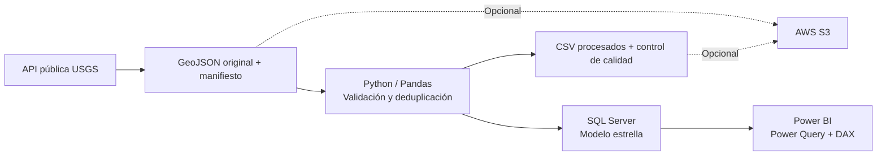
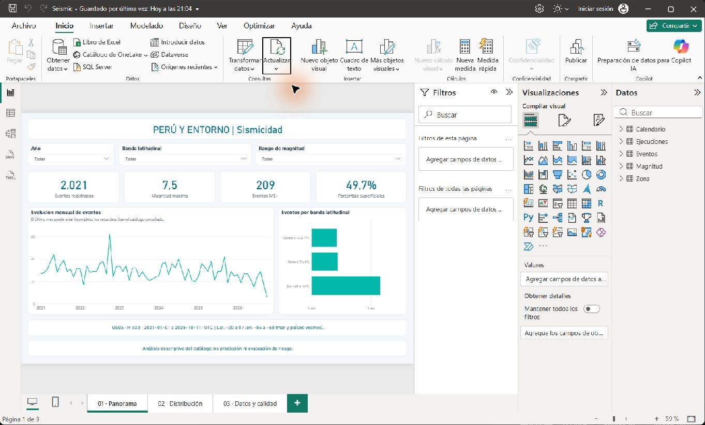
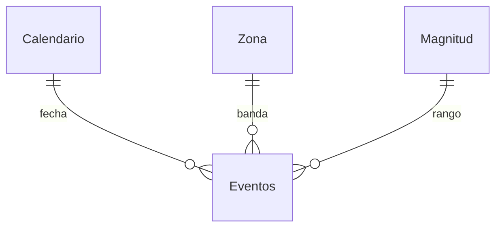

# Peru Seismic Analytics

[](https://github.com/OleOle19/peru-seismic-analytics/actions/workflows/quality.yml)

**Python · Pandas · SQL Server · Power BI · AWS S3**

Pipeline de análisis de sismicidad de **Perú y entorno** con datos públicos reales de USGS. Integra extracción por API, limpieza y transformación con Python/Pandas, almacenamiento relacional en SQL Server y un informe editable en Power BI. La carga a AWS S3 es opcional y fue verificada con una cuenta real.

## Objetivo

Explorar cómo se distribuyen los eventos del catálogo por tiempo, magnitud, profundidad y bandas latitudinales, con trazabilidad del origen y controles de calidad. El proyecto demuestra procesamiento reproducible, modelado de datos, consultas SQL y visualización de indicadores.

No predice terremotos ni evalúa el riesgo de una ciudad. Sus resultados describen una extracción del catálogo USGS; no representan necesariamente todos los sismos ocurridos.

## Arquitectura



S3 conserva originales y procesados como archivo de extracción. El flujo local no depende de descargar de S3 para cargar SQL Server. Se verificó la carga de 14 archivos en S3, con comparación SHA-256 y cifrado SSE-S3.

## Alcance de los datos

- Fuente: [USGS Earthquake Catalog API](https://earthquake.usgs.gov/fdsnws/event/1/).
- Primera ejecución: 2021-01-01 hasta 2026-10-12, fin excluido, en UTC.
- Magnitud mínima: 3.5.
- Área: latitud -20 a 0; longitud -84 a -68. Incluye territorio peruano, mar y partes de países vecinos.
- Zonas: bandas analíticas Norte, Centro y Sur. No son departamentos ni fronteras nacionales.
- Cada evento se identifica por su ID de USGS. Si hay duplicados, prevalece la revisión con mayor `updated`.
- Se conservan magnitud, tipo de magnitud, fecha UTC, profundidad, coordenadas, ubicación informada, estado y enlace a la fuente.

Consulta [los resultados obtenidos](docs/Resultados.md). No comparar un mes o año parcial con periodos completos sin ajustar el análisis.

## Requisitos

1. Python 3.11 o posterior. Probado con Python 3.13.
2. SQL Server local y ODBC Driver 18 for SQL Server. Probado con SQL Server 2025.
3. Power BI Desktop de Microsoft. No se necesita Power BI Pro para trabajar localmente.
4. Internet para consultar USGS y para instalar dependencias.
5. Opcional: cuenta AWS, bucket S3 y perfil de acceso con permisos de carga.

La API pública no requiere clave. La configuración y las credenciales se mantienen fuera del repositorio.

## Inicio rápido en Windows

```powershell
git clone https://github.com/OleOle19/peru-seismic-analytics.git
cd peru-seismic-analytics
./Instalar.ps1
./Actualizar-Datos.ps1 -Desde 2021-01-01 -Hasta 2026-10-12
./Abrir-Dashboard.ps1
```

El archivo `.env.example` documenta la conexión. La ejecución local usa autenticación de Windows. El cargador solo escribe en la base dedicada **SeismicAnalytics**, que crea si no existe.

El loader reemplaza la instantánea completa de eventos dentro de una transacción y conserva el historial de ejecuciones. Esto evita que sobrevivan eventos que dejaron de cumplir el filtro después de una revisión de USGS. No es una carga incremental: es una decisión explícita para este volumen y alcance.

En Power BI abre `powerbi/Seismic.pbip`. Si pide aplicar cambios, acepta la carga del modelo. Usa **Actualizar** y autenticación **Windows** para `localhost / SeismicAnalytics`. Si se solicita confianza en el certificado del servidor local, revisa esa decisión en el diálogo; el proyecto no modifica las opciones de seguridad de Power BI. Consulta [la guía del dashboard](docs/PowerBI.md).

## Informe Power BI

La copia `powerbi/Seismic.pbix` incluye los datos de la extracción verificada y permite abrir el informe directamente. El proyecto `Seismic.pbip` permite trabajar con las definiciones versionables y cargar desde SQL Server.



- **Panorama:** indicadores, filtros por año/zona/magnitud, evolución mensual y distribución por banda.
- **Distribución:** magnitud, profundidad, ubicación por coordenadas y medidas descriptivas.
- **Datos y calidad:** tabla de eventos, registros recibidos/rechazados, duplicados eliminados y fecha de extracción.

El proyecto está en formato PBIP/PBIR y contiene un modelo de importación TMSL (`model.bim`). Las definiciones son texto versionable; los datos se cargan desde SQL Server. Puedes guardar una copia `.pbix` desde Power BI Desktop. No se publica automáticamente en Power BI Service.

## Modelo de datos



Grano de `FactEvent`: un evento único del catálogo USGS. Dimensiones: fecha, banda latitudinal y rango de magnitud. El calendario incluye todos los días del periodo, aunque no existan eventos. `ETLRun` registra la trazabilidad y permanece separado de las relaciones analíticas.

Las relaciones del modelo Power BI filtran desde las dimensiones hacia los hechos. Las medidas DAX incluyen conteos, máximo/media de magnitud, porcentaje superficial y comparaciones temporales. La magnitud es logarítmica: su media es una descripción del catálogo, no una estimación de energía.

## Calidad y reproducibilidad

Validación local realizada: 15 pruebas de procesamiento, integridad y manejo de fallos, 39 archivos de metadatos validados con los esquemas públicos de Microsoft y carga real en Power BI Desktop. Los indicadores DAX coincidieron con SQL Server: 2.021 eventos, magnitud máxima 7,5 y 209 eventos M5+. La carga opcional a S3 fue verificada en AWS (14 archivos, integridad SHA-256 y cifrado SSE-S3).

- Descarga dividida por años, con comprobación contra truncamiento de la API.
- Reintentos acotados para errores transitorios y límites HTTP.
- Validación de coordenadas, magnitud, profundidad y timestamps.
- Los valores esenciales desconocidos se rechazan; no se inventan ni se convierten a cero.
- Intervalo `[inicio, fin)` y filtros aplicados de nuevo tras descargar.
- Duplicados resueltos por la última revisión de USGS.
- Originales y manifiesto con SHA-256 para rastrear la extracción, incluso al reutilizar archivos locales.
- Carga transaccional con claves, relaciones, restricciones y bloqueo entre escritores. Los CSV publicados se reemplazan después de una carga SQL exitosa; no existe una transacción distribuida entre SQL, archivos y S3.
- Repetir la misma extracción no multiplica eventos.

Los datos y cachés están excluidos de Git. Para compartir resultados públicos se pueden adjuntar un ZIP de la extracción o capturas, conservando fuente, periodo y filtros. Las futuras extracciones pueden cambiar por revisiones del catálogo.

## Comandos de desarrollo

```powershell
./.venv/Scripts/python.exe -m pytest tests -q
./.venv/Scripts/python.exe scripts/validate_powerbi.py
./.venv/Scripts/python.exe run_pipeline.py --from-raw data/raw/ID_DE_EJECUCION --start 2021-01-01 --end 2026-10-12
./.venv/Scripts/python.exe scripts/build_powerbi.py
```

`sql/analysis.sql` contiene consultas de evolución mensual, cambios porcentuales, bandas geográficas y trazabilidad. `powerbi/Medidas.dax` permite estudiar las medidas del informe.

### Alternativa sin SQL Server

```powershell
./.venv/Scripts/python.exe run_pipeline.py --no-sql --start 2021-01-01 --end 2026-10-12
./.venv/Scripts/python.exe scripts/build_powerbi.py --source csv
```

La alternativa CSV permite probar el informe local, pero no demuestra una integración activa con SQL Server. Las rutas del modelo se generan para la ubicación del proyecto; vuelve a ejecutar el generador si lo mueves.

## AWS S3 (opcional)

Para configurar o renovar el acceso, sigue [la configuración de S3](docs/AWS.md). Configura el perfil fuera del repositorio y define `AWS_S3_BUCKET` en `.env`. Ejecuta `Actualizar-Datos.ps1 -SubirS3` solo después de revisar costes y permisos de tu cuenta. El programa usa boto3, carga objetos con cifrado SSE-S3 y verifica su contenido por SHA-256 al leerlos de vuelta. No crea cuentas, buckets ni permisos automáticamente.

## Estructura

```text
src/seismic/        Extracción, limpieza, SQL, S3 y resultados
sql/                Esquema, vistas y consultas de análisis
powerbi/            Proyecto editable y medidas DAX
scripts/            Generación y validación del informe
tests/              Pruebas de casos de calidad y límites
data/raw/           Extracciones originales (local, fuera de Git)
data/processed/     Tablas procesadas (local, fuera de Git)
docs/               Resultados, Power BI, AWS y decisiones técnicas
infra/              Plantilla de permisos mínimos para S3
.github/workflows/  Pruebas y validación de metadatos en GitHub Actions
```

## Referencias

- [API oficial USGS](https://earthquake.usgs.gov/fdsnws/event/1/).
- [Limitaciones de predicción sísmica, USGS](https://www.usgs.gov/faqs/can-you-predict-earthquakes).
- [Proyectos de Power BI Desktop](https://learn.microsoft.com/en-us/power-bi/developer/projects/projects-overview).
- [Formato de informes PBIR](https://learn.microsoft.com/en-us/power-bi/developer/projects/projects-report).

## Decisiones y mejoras futuras

Consulta [las decisiones técnicas](docs/Decisiones.md) para conocer los compromisos del diseño y las limitaciones actuales.

## Licencia

El código del proyecto se distribuye bajo licencia MIT. Los datos conservan su atribución a USGS; las herramientas y bibliotecas mantienen sus propias licencias.
